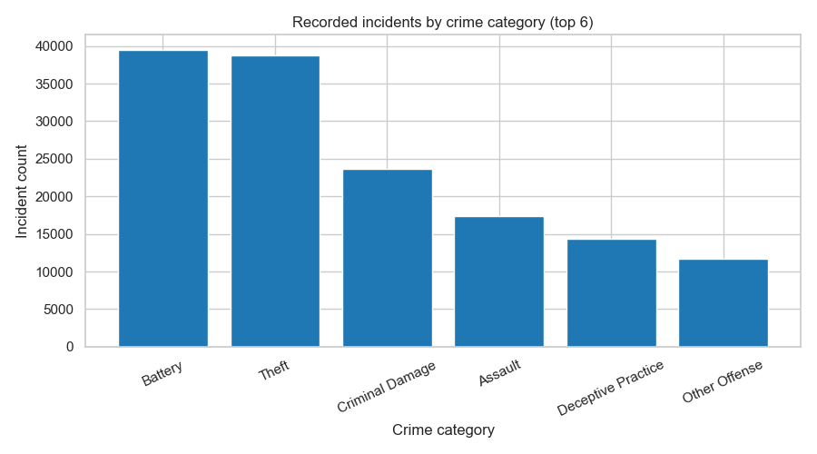
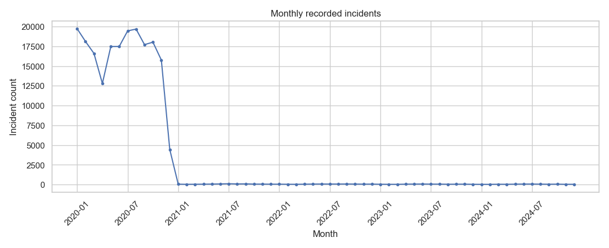
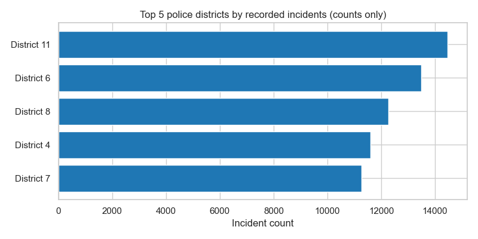
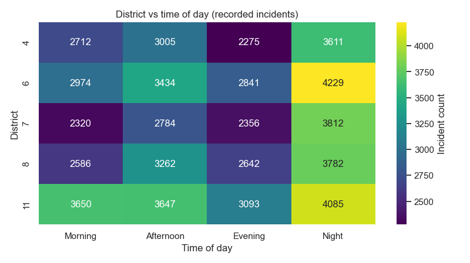
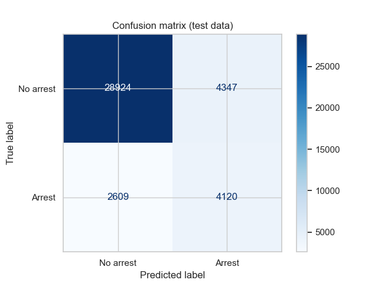
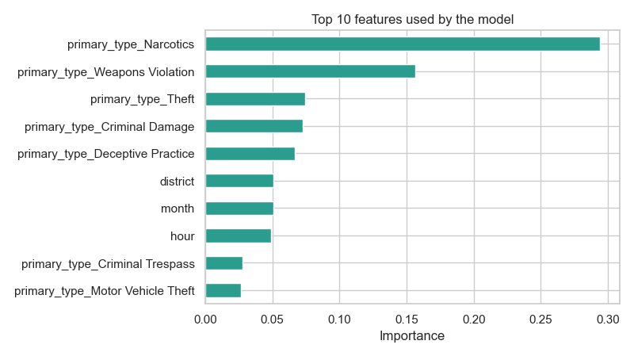

# crime-data-analysis-and-visualization
A Python-based project for analyzing crime data, identifying patterns, and visualizing crime statistics using data analysis and visualization techniques.

# Crime Data Analysis and Visualization

## Project Overview

This project analyzes Chicago crime data using Python. It identifies crime patterns, trends, and distributions and presents the findings through visualizations.

It also uses a Random Forest Classifier to predict whether an arrest was recorded for a crime incident.

## Objectives

- Clean and preprocess crime data.
- Analyze crime categories, monthly trends, police districts, and time periods.
- Create visualizations to understand crime patterns.
- Build and evaluate a machine learning classification model.

## Technologies Used

- Python
- Pandas
- NumPy
- Matplotlib
- Seaborn
- Scikit-learn

## Machine Learning Model

Random Forest Classifier

The model predicts the recorded arrest status using crime category, district, hour, day of the week, month, and domestic incident status.

## Project Files

- `crime_data_analysis_and_visualization.py` – Main Python program.
- `chicago_crimes.csv` – Input dataset required to run the program.
- `requirements.txt` – Python libraries required for the project.
- `output/` – Generated graphs and cleaned dataset.

## How to Run

1. Download or clone this repository.
2. Install the required Python libraries using `pip install -r requirements.txt`.
3. Place `chicago_crimes.csv` in the project folder.
4. Run the Python program:

   `python crime_data_analysis_and_visualization.py`

5. View the generated graphs and cleaned dataset in the `output` folder.

## Project Visualizations

### Graph 1: Crime Categories

### Graph 2: Monthly Crime Trends

### Graph 3: Top Police Districts

### Graph 4: District vs Time of Day

### Graph 5: Confusion Matrix

### Graph 6: Feature Importance

## Author

Aarti Kolhapure  
T.Y. B.Sc. Data Science  
Academic Year 2026–2027
